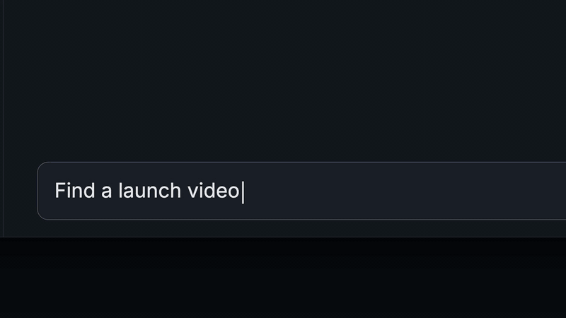

# cliphou.se

**Launch videos for what you ship.**

Find a motion graphics template inside your coding agent or chat app, fill it from your repo, and get an editable video. Free, MIT-0, no account.

[](https://github.com/sunmer/cliphouse/releases/download/demo-v1/cliphouse-agent-demo.mp4)

[Watch the full demo (31 seconds)](https://github.com/sunmer/cliphouse/releases/download/demo-v1/cliphouse-agent-demo.mp4), or see it play at [cliphou.se/agents](https://cliphou.se/agents/). Some steps in it are coming soon. See [Status](#status).

## Install

<table>
<tr>
<th width="50%">Coding agents (Codex, Claude Code)</th>
<th width="50%">Chat apps (Claude, ChatGPT, Cursor)</th>
</tr>
<tr>
<td valign="top">

```bash
npx skills add sunmer/cliphouse
```

Installs the `cliphouse` skill. It needs Node 18 or later, has no dependencies, and runs no commands besides its own helper.

In Codex you can also run `$skill-installer install https://github.com/sunmer/cliphouse/tree/main/skills/cliphouse`.

</td>
<td valign="top">

MCP server URL, no key needed:

```text
https://cliphou.se/mcp
```

[Add to Cursor](cursor://anysphere.cursor-deeplink/mcp/install?name=cliphouse&config=eyJ1cmwiOiJodHRwczovL2NsaXBob3Uuc2UvbWNwIn0=) · [Add to VS Code](vscode:mcp/install?%7B%22name%22%3A%22cliphouse%22%2C%22type%22%3A%22http%22%2C%22url%22%3A%22https%3A%2F%2Fcliphou.se%2Fmcp%22%7D)

Claude.ai and ChatGPT: add a custom connector with the URL above.

</td>
</tr>
</table>

Claude Code with MCP instead of the skill:

```bash
claude mcp add --transport http cliphouse https://cliphou.se/mcp
```

Codex with MCP, in `~/.codex/config.toml`:

```toml
[mcp_servers.cliphouse]
url = "https://cliphou.se/mcp"
```

GitHub does not open `cursor://` and `vscode:` links from a README in every browser. If a link does nothing, use the buttons on [cliphou.se/agents](https://cliphou.se/agents/).

## Try it

Open your project and ask:

> Deploy to prod. Btw we need a launch video.

> Make a 10-second vertical changelog video for v2.3.

> Turn this release into a 16:9 video for our landing page.

In Codex, type `$cliphouse` to call the skill directly.

## Status

| In the demo | Status |
| --- | --- |
| Template grid in the chat, click or number to pick | Available |
| Filling the template from your repo, and editing it by prompt | Available. You get a cliphou.se editor link, where you export the MP4. |
| A preview of your own product in the picked template | Available as a poster image. An animated preview is coming. |
| Previews that turn into your product inside the grid | Coming soon. Today the grid shows each template's demo copy. |
| Posting to X from the agent | Coming soon. Today the agent writes the caption and opens the X post window for you to attach the MP4. |

## Skills in this repo

| Skill | Does | Install |
| --- | --- | --- |
| `cliphouse` | Search, preview, fill from your repo, editor link, share. Reads public cliphou.se data only. | `npx skills add sunmer/cliphouse` |
| `cliphouse-render` (optional) | Renders the MP4 in your project, or lets the agent change layout, motion, and timing in code. Asks before it downloads or installs anything. | `npx skills add sunmer/cliphouse --skill cliphouse-render` |

## How it works

`skills/cliphouse/scripts/cliphouse.mjs` talks to the public cliphou.se catalog over HTTPS. Search uses the cliphou.se MCP server, so the skill and the MCP tools rank templates the same way.

| Command | Does |
| --- | --- |
| `search "<query>" [--aspect 9:16] [--max-seconds 20] [--inline]` | Finds templates. `--inline` caches the preview MP4s and prints a Markdown grid. |
| `picker <id>... --out <file.html>` | Builds the clickable, autoplaying preview grid for Codex. |
| `spec <id>` | Prints the editable text, colors, and limits. |
| `preview <id> <props.json>` | Renders a poster of your product in the template on the server, and prints the editor link. |
| `link <id> <props.json>` | Validates the edit and prints a cliphou.se editor link. |
| `pick <id>...` | Writes a side-by-side preview page for terminals and prints its path. The agent asks before opening it. |

What the default skill does not do:

- It does not run `npm`, `curl`, `tar`, or any command from a downloaded spec.
- It does not download source packages into your repo.
- It does not open your browser on its own.

It caches preview files only from `https://cliphou.se/previews/`, in `~/.cache/cliphouse`. Set `CLIPHOUSE_ORIGIN` to use another host.

In the Codex picker, a click on a tile sends one fixed message: `$cliphouse: use template <id> and fill it for this project`. It is sent only on your click, and the id must match `^[a-z0-9-]+$`.

`cliphouse-render` uses fixed render commands written in its `SKILL.md`. It checks each package against `source.packageSha256` before it extracts it into `.cliphouse/<id>/`, and asks before it adds `.cliphouse/` to `.gitignore` or installs dependencies.

## Links

- [cliphou.se/agents](https://cliphou.se/agents/): install page with the demo
- [MCP Registry entry](https://registry.modelcontextprotocol.io/v0.1/servers?search=se.cliphou%2Ftemplates) (`se.cliphou/templates`)
- [llms.txt](https://cliphou.se/llms.txt)
- [Gallery](https://cliphou.se/)

## License

MIT-0. Templates rendered locally use Remotion or HyperFrames, which have their own licenses.
